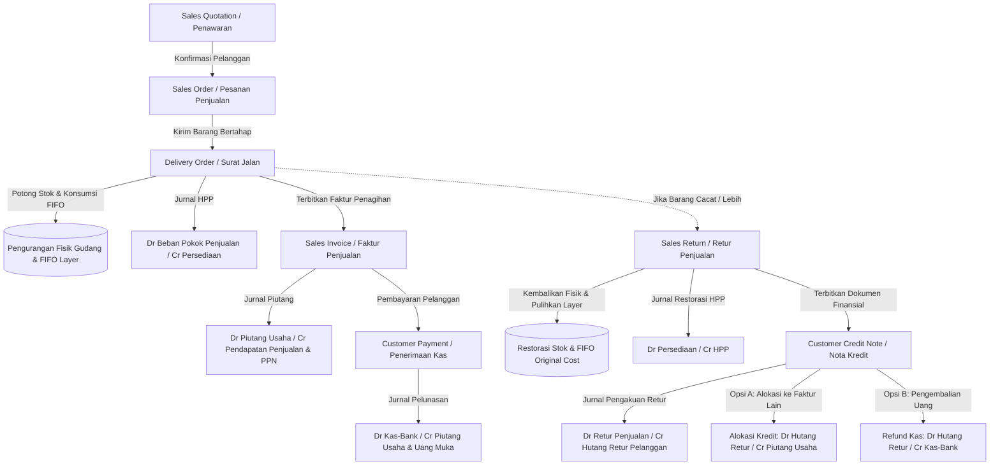
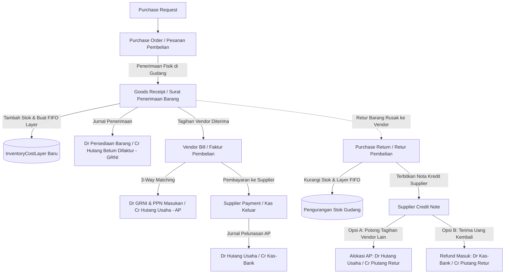
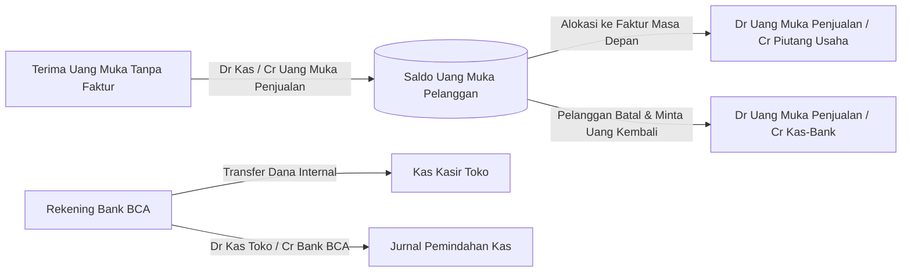

# KLEDO ERP — WORKFLOW CATALOG & ARCHITECTURAL BLUEPRINT
## Complete Business Process Lifecycles & State Transitions

Berikut adalah katalog rekonstruksi alur kerja (*business workflow catalog*) end-to-end yang dianalisis dari praktik ERP modern Indonesia (Kledo) dan dicocokkan dengan arsitektur TATALORA:

---

### 1. SIKLUS PENJUALAN LENGKAP (ORDER-TO-CASH & RETURN)

#### Aturan Bisnis & Batasan:
- **Pemisahan Pengiriman vs Penagihan:** Delivery Order memotong fisik stok dan mencatat HPP tanpa memicu pengakuan piutang (AR). Faktur Penjualan mengakui AR dan Pendapatan tanpa memotong stok kedua kali.
- **Invarian Faktur:** `Kuantitas Difakturkan <= Kuantitas Terkirim (DONE)`.
- **Restorasi FIFO:** Retur Penjualan melacak `CostLayerConsumption` dari surat jalan asal, memulihkan kuantitas kembali ke biaya perolehan asli (*weighted original cost*), dan menerbitkan dedicated `CustomerCreditNote` (tanpa membuat faktur negatif).

---

### 2. SIKLUS PEMBELIAN LENGKAP (PROCURE-TO-PAY & SUPPLIER RETURN)

#### Aturan Bisnis & Batasan:
- **Model Akun Kliring GRNI (Goods Receipt Not Invoiced / 2-1150):** Mengisolasi perbedaan waktu antara kedatangan fisik barang di gudang dengan tibanya invoice dari vendor.
- **Pemisahan Nota Kredit:** Supplier Credit Note dicatat sebagai aset lancar (Piutang Retur Pembelian / `1-1420`), sehingga saldo histori pembayaran faktur asal tetap aman dan tidak dirusak.

---

### 3. SIKLUS KAS, BANK & MANAJEMEN UANG MUKA (TREASURY)

#### Aturan Bisnis & Batasan:
- **Pemisahan Uang Muka vs Nota Kredit:** Pengembalian uang muka murni (*Customer Advance Refund*) mengurangi kewajiban Uang Muka Penjualan (`2-1200`), sedangkan pengembalian nota kredit (*Customer Credit Refund*) mengurangi kewajiban Hutang Retur Pelanggan (`2-1210`). Keduanya tidak boleh saling mencemari.
- **Idempotensi & Concurrency:** Penguncian baris `Payment` (`SELECT FOR UPDATE`) menjamin bahwa alokasi faktur dan pengembalian dana yang terjadi bersamaan tidak menghasilkan saldo deposit negatif.
