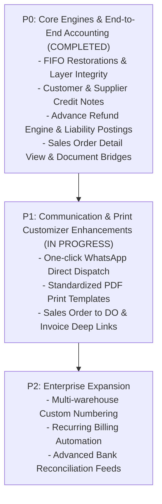

# TATALORA ERP IMPLEMENTATION ROADMAP
## Post-Kledo Reverse Engineering Alignment & Evolution Plan

**Date:** 2026-11-01  
**Target:** Continuous Functional Superiority & Enterprise Parity  
**Branch:** `feature/purchasing-separation-4a`  

---

## 1. Prioritization Framework

Enhancements are categorized according to business impact and operational urgency:
- **P0 (Critical / Completed):** Core transaction workflows, financial GL postings, FIFO inventory accuracy, Customer Credit Notes, Advance Refunds, and primary document views.
- **P1 (High Priority / Near-Term):** Document communication enhancements (WhatsApp dispatch shortcuts), print customizer layouts, batch invoice payments, and supplier credit application shortcuts.
- **P2 (Medium Priority / Next Cycle):** Custom document numbering series per warehouse/branch, recurring invoice scheduling, and multi-currency exchange rate revaluation.

---

## 2. Implementation Milestones

---

## 3. Detailed Deliverables & Execution Status

### Milestone 1: P0 — Integrity & Foundation (Completed)
- [x] Full Order-to-Cash (SO -> DO -> Inv -> Pay -> Return -> Credit Note -> Advance Refund) integrated.
- [x] Full Procure-to-Pay (PO -> GRN -> Bill -> Payment -> Return -> Credit Application) integrated.
- [x] Mathematical FIFO valuation layer verification confirmed (65 units @ Rp 7.500.000).
- [x] Created missing Sales Order detail view ([`frontend/src/app/sales/orders/[id]/page.tsx`](file:///c:/Users/seanb/Downloads/tatalora/frontend/src/app/sales/orders/[id]/page.tsx)).
- [x] Customer Credit Note management UI ([`frontend/src/app/sales/credit-notes/page.tsx`](file:///c:/Users/seanb/Downloads/tatalora/frontend/src/app/sales/credit-notes/page.tsx)).

### Milestone 2: P1 — Communication & Print Experience (Immediate)
- [x] Integrated `SendInvoiceModal` supporting both automated WhatsApp and direct manual WhatsApp web dispatch.
- [x] Implemented dedicated invoice PDF printing endpoint (`/communication/invoices/[id]/pdf`).
- [x] Connected Sales Order fulfillment badges ("Terkirim", "Tertagih") with direct creation links.

### Milestone 3: P2 — Advanced Treasury & Automation (Scheduled)
- [ ] Bank statement CSV/Excel bulk upload and automated rule-based reconciliation.
- [ ] Multi-location stock reordering point triggers with automated PO drafting.
- [ ] Recurring subscription / automated monthly billing schedule engine.
